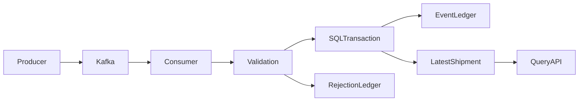

# Architecture and review guide

## Execution boundaries

A Kafka producer emits versioned shipment events keyed by shipment ID. A consumer validates each event, commits the event ledger and latest shipment state in one SQL transaction, and advances its Kafka offset only afterward. Poison messages go to a durable SQL rejection ledger. A FastAPI query service reads warehouse aggregates and shipment state. The store supports PostgreSQL for deployment and SQLite for deterministic local tests.

## Decisions to review

At-least-once Kafka delivery with an idempotent SQL sink, not distributed exactly-once transactions. Event IDs must remain stable on replay. Source versions determine ordering; event timestamps are retained but do not close event-time windows. A single-node broker is a development topology. API endpoints are read-only and require an authentication gateway before exposure. Tests exercise SQLite persistence, replay, failures, and HTTP endpoints; Kafka/PostgreSQL Compose checks require Docker.

## Failure exercise

1. Run the supplied synthetic example and record its state or output.
2. Run the same input again. Inspect the replay policy: event/batch idempotency for transactional systems, stable latest-state results for CDC, pinned versions for contracts, and explicit output prefixes for Beam.
3. Introduce a malformed input and run the tests that exercise rejection. Check whether the contract requires quarantine or whole-batch failure before re-running.
4. Stop the persistence service during a write when using a deployed topology. Confirm that the consumer/scheduler does not advance its source checkpoint before the sink commits.
5. Recover from the retained input. Inspect receipts, rejects, run metadata, or comparison reports instead of assuming a successful process exit implies end-to-end correctness.

Steps requiring Kafka, PostgreSQL, Airflow, Spark, or containers are deployment exercises, not claims that those environments were tested here. See `VALIDATION.md` for executed evidence.

## Portfolio discussion

Be prepared to explain the input grain, key/version contract, transaction boundary, retained state, failure recovery, and the changes required for multiple workers or a cloud deployment. The implementation deliberately exposes these decisions rather than claiming scale from a small synthetic example.
